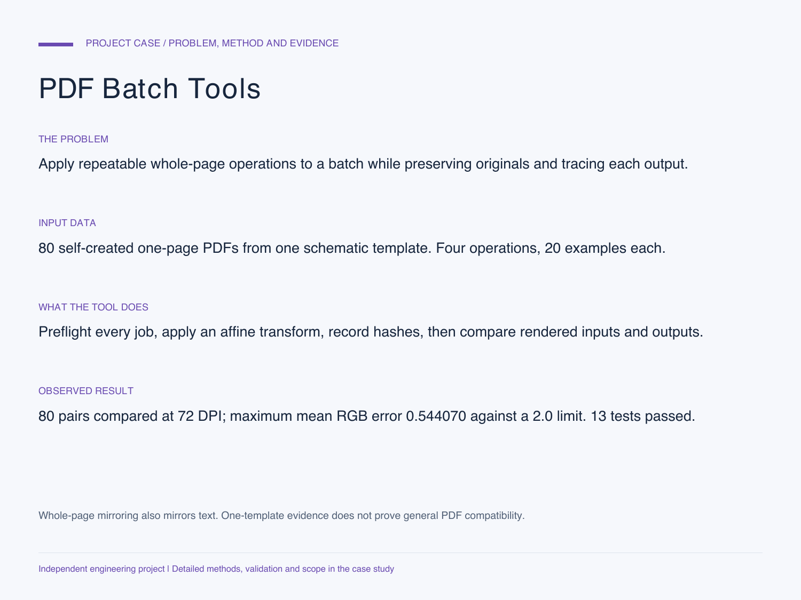

# PDF Batch Tools

[中文](README.md) | **English**

Manifest-driven whole-page transformations with preflight validation, preserved source files and per-file evidence.

[Detailed case study: problem, data, method, evidence and limits](CASE_STUDY.md)

**Independent engineering demonstration using self-created schematic PDFs, not client documents or construction drawings.**

## Reproduce

Requires Python 3.10+, pypdf and ReportLab.

    python -m pip install -r requirements.txt
    python -m unittest -v
    python demo.py --output demo-output
    python pdf_batch.py jobs.json --output new-results

Use a new output directory for every run. The demonstration makes 80 one-page PDFs, processes 20 with each operation, and writes an output manifest with SHA-256 hashes, page counts and page dimensions.

## Manifest contract

    {
      "version": 1,
      "jobs": [
        {
          "input": "inputs/schematic.pdf",
          "output": "mirrored.pdf",
          "operation": "mirror_horizontal"
        }
      ]
    }

Supported operations: `mirror_horizontal`, `mirror_vertical`, `rotate_180`, and `copy`. Input paths must remain within the manifest directory; output names must be simple, unique PDF filenames.

## Verified demonstration

- 80 input files and 80 output files, each with one page.
- All 80 input/output pairs rendered at 72 DPI and compared with the requested geometric transform. Detailed measurements are in `render_verification.json`.
- These are 80 numbered instances of one self-created template, not 80 independent document types. The mean RGB error limit is 2.0 on a 0-255 scale; this is not a percentage accuracy score.
- Thirteen automated tests cover structural preservation, source hashes, unsupported inputs, duplicate names, path traversal, preflight failure and no-overwrite behavior.
- Representative before/after PDFs are supplied as `sample_input.pdf` and `sample_mirrored.pdf`.

## Important boundaries

**Mirroring the whole page mirrors its text too.** Keeping labels readable while reversing only diagram geometry is a different requirement and is not implemented here. Agree on that distinction before using a client drawing.

Forms, annotations, document actions, named/embedded objects, rotated input pages, non-default user units, and nonzero/different media-crop boxes are rejected for separate handling. Limits: 20 MiB per input, 100 pages per file, 500 jobs, and 100 MiB of prepared output per batch.

Inputs are preflighted before output creation. Disk errors can still leave an incomplete new output directory, and there is no resume or automatic upload workflow. This tool is not a hostile-PDF security sandbox or a guarantee of arbitrary-PDF fidelity. The rendered validation covers the supplied synthetic fixtures, not every PDF producer or client system.

## Project notes

`verify_rendering.py demo-output --output render-check` repeats the one-page fixture comparison after installing Pillow and Poppler. See the detailed case for the exact environment and commands. `verification.json` records the test methods and source hashes.

The source, fixtures and verification procedure document the demonstrated capability. No client documents, restricted drawings or architectural credentials are claimed.
